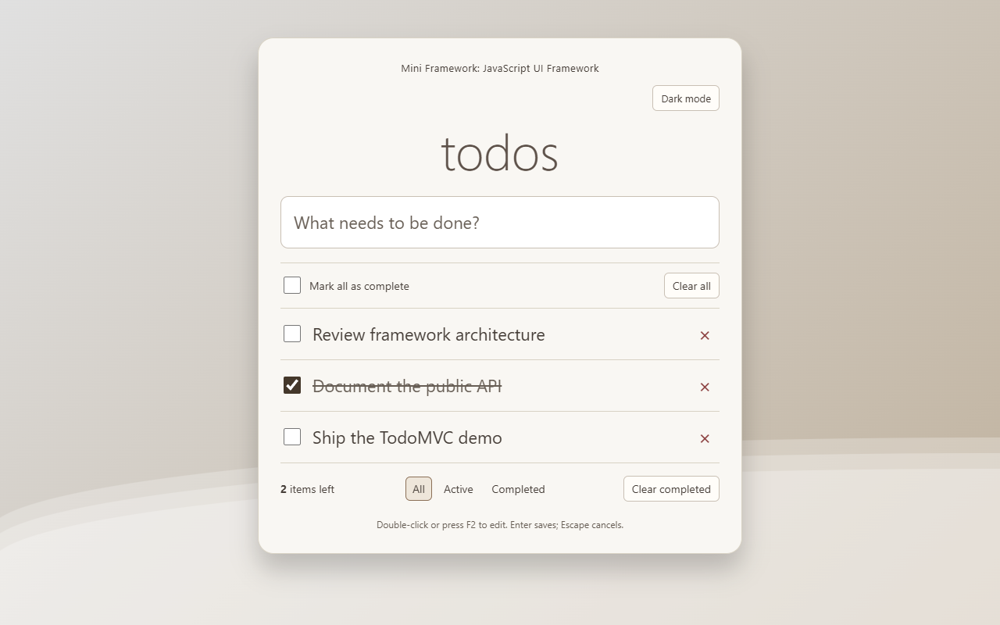

# Mini Framework: JavaScript UI Framework

A lightweight JavaScript UI framework built from scratch, with a TodoMVC demo that brings its features together. Built with vanilla JavaScript and no external dependencies.



## Features

### Framework

- Virtual DOM rendering with keyed lists and targeted DOM updates.
- Shared state management with subscriptions and batched updates.
- Declarative event handlers and a custom event bus.
- URL-based routing with browser Back/Forward support.
- Render scheduling that preserves input focus and cursor position.

### TodoMVC demo

- Add, edit, complete, and delete tasks.
- Filter by All, Active, or Completed.
- Track remaining tasks, toggle all tasks, and clear completed tasks.
- Save tasks locally across page reloads.
- Switch between light and dark mode, with a saved preference.
- Edit with the keyboard: F2 to start, Enter to save, and Escape to cancel.
- Responsive layout, accessible controls, and reduced-motion support.

## Built with

JavaScript (ES modules), HTML, CSS, browser APIs, and Node.js for the local server. No UI libraries or build tools are required.

## Getting started

You need **Node.js 22 or newer** and a modern browser.

From the project folder, run:

```sh
npm start
```

Open **http://127.0.0.1:3000**. No dependency installation or build step is needed.

On Windows PowerShell, use `npm.cmd start` if `npm start` is blocked by the execution policy. The local server also supports `PORT` and `HOST` environment variables.

## How it works

Views describe the UI using JavaScript objects. When state changes, the framework schedules a render and updates the affected DOM nodes. Stable keys help keep list items and inputs consistent as the UI changes.

The TodoMVC app uses these same APIs for task updates, events, and filter navigation.

## Quick example

This counter demonstrates nested elements, attributes, events, and state updates:

```js
import { h } from '/framework/vdom.js';
import { createStore } from '/framework/store.js';
import { mount } from '/framework/core.js';

const store = createStore({ count: 0 });

mount(document.getElementById('app'), state =>
  h('div', { class: 'counter' },
    h('p', {}, 'Count: ' + state.count),
    h('button', {
      type: 'button',
      onclick: () => store.setState(current => ({ count: current.count + 1 }))
    }, 'Increment')
  ), store
);
```

Use this in the browser with the local server running. See the [tutorial](TUTORIAL.md) for a complete example with routing and details on each API.

## Project structure

```text
framework/
  core.js        Rendering and routing
  events.js      Event bus
  store.js       State management
  vdom.js        Virtual DOM and DOM updates
todomvc/
  app.js         TodoMVC application
  index.html     Browser entry point
  style.css      Demo styling
docs/
  preview.png    Demo screenshot
server.js        Local development server
TUTORIAL.md      Framework usage guide
```

## License

[MIT](LICENSE).
